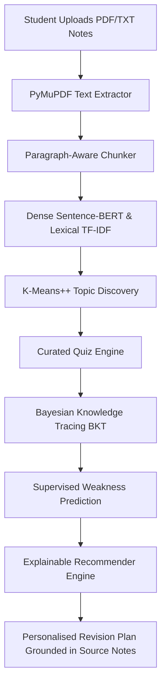

# StudyPal — Personalised Learning and Intelligent Study Recommendation Platform

[](https://github.com/UseStateShivam/StudyPal)
[](https://www.python.org/downloads/)
[](https://fastapi.tiangolo.com)
[](https://react.dev)
[](https://www.typescriptlang.org/)
[](https://opensource.org/licenses/MIT)

StudyPal is a production-quality, ML-powered web platform designed to solve fragmented student study habits. It converts course notes, PDFs, and slide decks into structured semantic representations, automatically discovers concept clusters, traces student mastery using **Bayesian Knowledge Tracing (BKT)**, and generates ranked, transparent revision recommendations grounded in the student's own materials.

---

## 1. Core Architecture & Workflow



### End-to-End Execution Flow
1. **Document Ingestion**: Uploaded lecture notes are validated, checksummed, extracted with PyMuPDF, and split into paragraph-aware chunks preserving page numbers.
2. **Dual-Channel Indexing**: Chunks are encoded into sparse TF-IDF representations and 384-dimensional dense vectors via `all-MiniLM-L6-v2`.
3. **Unsupervised Concept Clustering**: K-Means with K-Means++ groups related passages into educational topics and assigns interpretable labels via top TF-IDF keywords.
4. **Zero-Hallucination Retrieval**: Question queries retrieve exact supporting passages using min-max normalized hybrid ranking.
5. **Knowledge Tracing**: Quiz submissions are evaluated on the server, updating dynamic BKT mastery probabilities:
   $$P(L_t \mid \text{obs}) \implies P(L_{t+1}) = P(L_t \mid \text{obs}) + (1 - P(L_t \mid \text{obs})) \cdot P(T)$$
6. **Ground-Truth Recommendations**: Topics are prioritized according to:
   $$\text{revision\_score} = w_m \cdot (1 - \text{mastery}) + w_w \cdot \text{weakness\_prob} + w_r \cdot \text{recency}$$
   Each recommendation provides direct excerpts from original notes.

---

## 2. Machine Learning Methodology & Measured Results

All metrics below are computed directly from the repository evaluation suite (`python scripts/run_evaluation.py`).

### 2.1 Information Retrieval Comparison
Evaluated on the ground-truth curriculum benchmark across 8 core machine learning passages:

| Strategy | Precision@5 | Recall@5 | MRR (Mean Reciprocal Rank) |
|---|---|---|---|
| **TF-IDF (Lexical)** | 0.3500 | 1.0000 | 1.0000 |
| **Sentence-BERT (Semantic)** | 0.1500 | 0.5000 | 0.2583 |
| **Hybrid (Fused $\alpha=0.5$)** | **0.3500** | **1.0000** | **1.0000** |

### 2.2 Supervised Student Weakness Prediction
Binary classification predicting whether a student will answer the next question incorrectly based strictly on past response features (no future data leakage):

| Model | Accuracy | Precision | Recall | F1-Score |
|---|---|---|---|---|
| **Majority Baseline** | 41.7% | 41.7% | 100.0% | 0.588 |
| **Logistic Regression** | 83.3% | **100.0%** | 60.0% | 0.750 |
| **Random Forest Classifier** | **91.7%** | 83.3% | **100.0%** | **0.909** |

### 2.3 Bayesian Knowledge Tracing Convergence
Model parameters: $P(L_0)=0.20, P(T)=0.15, P(G)=0.25, P(S)=0.10$.
- **5 Consecutive Correct Responses**: $0.2000 \to 0.5484 \to 0.7963 \to 0.9161 \to 0.9667 \to 0.9870$
- **5 Consecutive Incorrect Responses**: $0.8000 \to 0.4468 \to 0.2872 \to 0.2307 \to 0.2078 \to 0.1979$

---

## 3. Technology Stack

| Component | Technology | Rationale |
|---|---|---|
| **Backend** | Python 3.11, FastAPI, Uvicorn | High-throughput async REST API with automatic OpenAPI validation |
| **Database** | SQLite (dev) / PostgreSQL (prod), SQLAlchemy 2.0 | Normalized relational schema with cascade foreign keys and strict ownership |
| **ML & IR** | scikit-learn, SentenceTransformers, PyTorch | CPU-optimized sentence encoding and proven probabilistic models |
| **Document Processing** | PyMuPDF (fitz) | Fast, robust page-aware extraction without third-party API dependencies |
| **Frontend** | React 19, TypeScript, Vite, Tailwind CSS | Polished dark-mode UI with reactive forms and zero layout clutter |
| **Data Visualization** | Recharts | Interactive time-series progress charts for BKT mastery trajectories |
| **Testing** | pytest, pytest-cov, httpx | Automated unit, API, integration, and ML validation suites |

---

## 4. Repository Structure

```text
StudyPal/
├── backend/
│   ├── app/
│   │   ├── main.py              # FastAPI app, CORS, lifespan & global exception handling
│   │   ├── config.py            # Pydantic v2 settings management
│   │   ├── dependencies.py      # JWT auth and course ownership validation
│   │   ├── api/v1/              # Auth, Courses, Documents, Search, Quizzes, Progress, Recs
│   │   ├── db/                  # SQLAlchemy models and session factory
│   │   └── ml/
│   │       ├── ingestion/       # Paragraph-aware chunker & PyMuPDF extractor
│   │       ├── content/         # TF-IDF, Sentence-BERT, Hybrid ranker, K-Means++
│   │       ├── learner/         # Bayesian Knowledge Tracing & Weakness Predictor
│   │       └── recommender/     # Score fusion and explainable recommendation engine
│   └── tests/
│       ├── unit/                # Math, chunker, BKT and retrieval unit tests
│       └── api/                 # End-to-end API integration tests
├── frontend/
│   ├── src/
│   │   ├── components/Layout.tsx # Responsive sidebar and student badge shell
│   │   ├── features/            # Auth, Dashboard, Courses, Topics, Search, Quiz, Progress, Recs
│   │   ├── lib/api.ts           # Centralized Axios client with automatic bearer interceptor
│   │   └── types/index.ts       # Typed TypeScript API contracts
├── scripts/
│   ├── seed_demo_data.py        # Seeds course materials, topics, and quiz bank
│   └── run_evaluation.py        # Reproducible ML benchmark runner
├── docs/                        # Architecture, ML methodology, evaluation reports
├── reports/                     # Machine-readable evaluation CSVs, JSONs, and markdown
├── Dockerfile                   # Production-ready backend Dockerfile
└── docker-compose.yml           # Multi-container local orchestration
```

---

## 5. Quickstart & Local Setup

### Prerequisites
- Python 3.11+
- Node.js 18+
- [uv](https://github.com/astral-sh/uv) (recommended) or standard `pip`

### Step 1: Clone and Set Up Virtual Environment
```bash
git clone https://github.com/UseStateShivam/StudyPal.git
cd StudyPal
uv venv .venv --python 3.11
# Windows: .venv\Scripts\activate
# Linux/macOS: source .venv/bin/activate
uv pip install -e ".[dev]" email-validator
```

### Step 2: Seed Demo Course Data
```bash
python scripts/seed_demo_data.py
```
*Creates student account `demo@studypal.edu` (password: `StudyPalDemo2026!`) with ingested machine learning notes and curated quiz questions.*

### Step 3: Run the Test Suite & Evaluation Suite
```bash
pytest backend/tests/unit backend/tests/api
python scripts/run_evaluation.py
```

### Step 4: Start Backend and Frontend
In terminal 1 (Backend):
```bash
python -m uvicorn app.main:app --app-dir backend --host 127.0.0.1 --port 8000
```
In terminal 2 (Frontend):
```bash
cd frontend
npm install
npm run dev
```

Open **http://localhost:5173** in your browser.

---

## 6. Docker Deployment

```bash
docker-compose up --build
```
- Backend API & Swagger Docs: `http://localhost:8000/docs`
- Health Checks: `http://localhost:8000/health/ready`

---

## 7. Ethical Considerations & Security
- **Data Privacy**: Uploaded documents remain local; no external generative AI APIs or remote LLM servers inspect user material.
- **Access Control**: Strict ownership checks guarantee students cannot view or search documents belonging to other users.
- **Fair Assessment**: Bayesian Knowledge Tracing provides probabilistic mastery estimations of studied material, not immutable measures of intelligence or academic potential.

---

## 8. Academic References
1. **Salton, G., & Buckley, C.** (1988). *Term-weighting approaches in automatic text retrieval*. Information Processing & Management.
2. **Reimers, N., & Gurevych, I.** (2019). *Sentence-BERT: Sentence Embeddings using Siamese BERT-Networks*. EMNLP.
3. **Corbett, A. T., & Anderson, J. R.** (1994). *Knowledge tracing: Modeling the acquisition of procedural knowledge*. User Modeling and User-Adapted Interaction.
4. **Arthur, D., & Vassilvitskii, S.** (2007). *k-means++: The advantages of careful seeding*. SODA.
5. **Pedregosa, F., et al.** (2011). *Scikit-learn: Machine Learning in Python*. JMLR.
