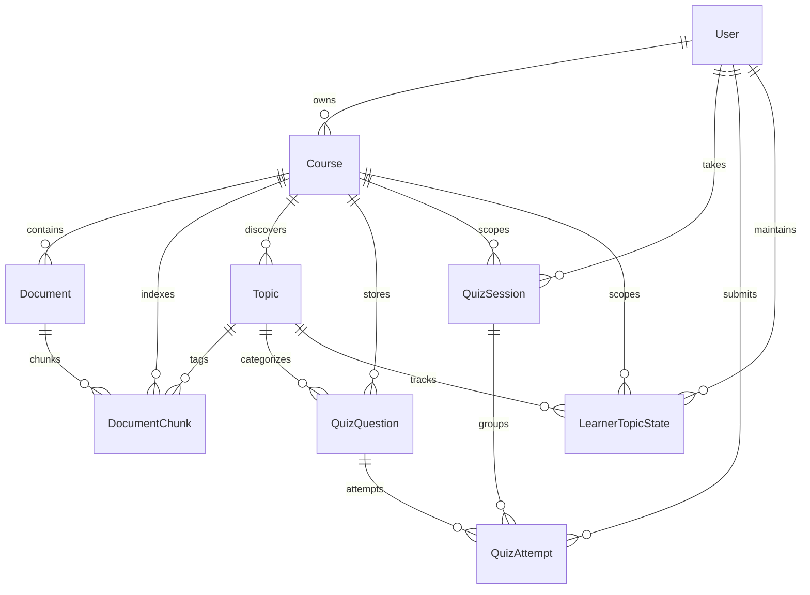

# StudyPal Database Documentation

StudyPal uses SQLAlchemy 2.0 with a normalized relational schema. It supports SQLite for local zero-config testing and PostgreSQL for multi-user deployment.

## Entity-Relationship Diagram

## Schema Entities & Constraints

### 1. `users`
- `id` (String UUID, PK)
- `email` (String 255, Unique, Indexed)
- `hashed_password` (String 255, bcrypt)
- `display_name` (String 100)
- `is_active` (Boolean)
- `created_at`, `updated_at` (DateTime UTC)

### 2. `courses`
- `id` (String UUID, PK)
- `owner_id` (FK `users.id` on delete CASCADE)
- `name` (String 200)
- `description` (Text)
- `created_at`, `updated_at` (DateTime UTC)

### 3. `documents`
- `id` (String UUID, PK)
- `course_id` (FK `courses.id` on delete CASCADE)
- `original_filename` (String 255)
- `storage_identifier` (String 255, Unique)
- `file_type` (`pdf`, `txt`)
- `file_size_bytes` (Integer)
- `content_checksum` (String 64, SHA-256)
- `processing_status` (`pending`, `processing`, `completed`, `failed`)
- `total_pages` (Integer)
- `chunk_count` (Integer)
- Composite Index: `(course_id, content_checksum)` to prevent duplicate uploads.

### 4. `document_chunks`
- `id` (String UUID, PK)
- `document_id` (FK `documents.id` on delete CASCADE)
- `course_id` (FK `courses.id` on delete CASCADE)
- `topic_id` (FK `topics.id` on delete SET NULL)
- `chunk_index` (Integer)
- `text_content` (Text)
- `word_count` (Integer)
- `page_number` (Integer)
- `embedding_vector` (Text, serialised 384-dimensional array)
- Composite Index: `(course_id, topic_id)`.

### 5. `topics`
- `id` (String UUID, PK)
- `course_id` (FK `courses.id` on delete CASCADE)
- `cluster_index` (Integer)
- `label` (String 100)
- `is_custom_label` (Boolean)
- `keywords` (Text)
- `chunk_count` (Integer)

### 6. `quiz_questions`
- `id` (String UUID, PK)
- `course_id` (FK `courses.id` on delete CASCADE)
- `topic_id` (FK `topics.id` on delete CASCADE)
- `question_text` (Text)
- `options_json` (Text array)
- `correct_option_index` (Integer)
- `explanation` (Text)
- `difficulty` (`easy`, `medium`, `hard`)
- `provenance` (`curated`, `imported`, `synthetic`)

### 7. `quiz_attempts`
- `id` (String UUID, PK)
- `user_id` (FK `users.id` on delete CASCADE)
- `course_id` (FK `courses.id` on delete CASCADE)
- `session_id` (FK `quiz_sessions.id` on delete CASCADE)
- `question_id` (FK `quiz_questions.id` on delete CASCADE)
- `topic_id` (FK `topics.id` on delete CASCADE)
- `selected_option_index` (Integer)
- `is_correct` (Boolean)
- `response_time_ms` (Integer)
- `attempted_at` (DateTime UTC)

### 8. `learner_topic_states`
- `id` (String UUID, PK)
- `user_id` (FK `users.id` on delete CASCADE)
- `course_id` (FK `courses.id` on delete CASCADE)
- `topic_id` (FK `topics.id` on delete CASCADE)
- `mastery_probability` (Float $[0.001, 0.999]$)
- `total_attempts` (Integer)
- `correct_attempts` (Integer)
- `recent_incorrect_count` (Integer)
- `current_streak` (Integer)
- `last_practiced_at` (DateTime UTC)
- `history_json` (Text, array of chronological trajectory points)
- Unique Constraint: `(user_id, course_id, topic_id)`
